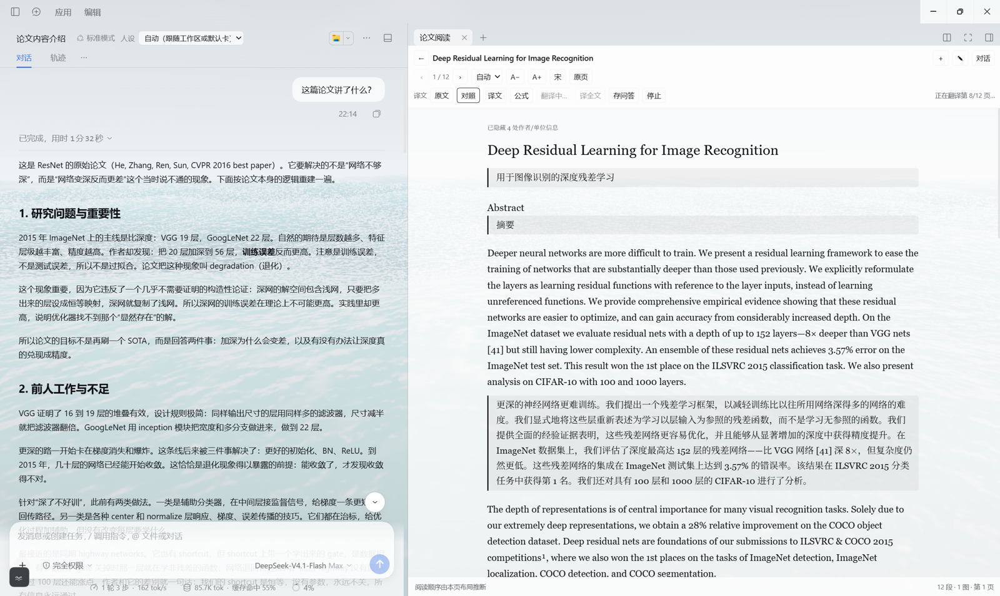
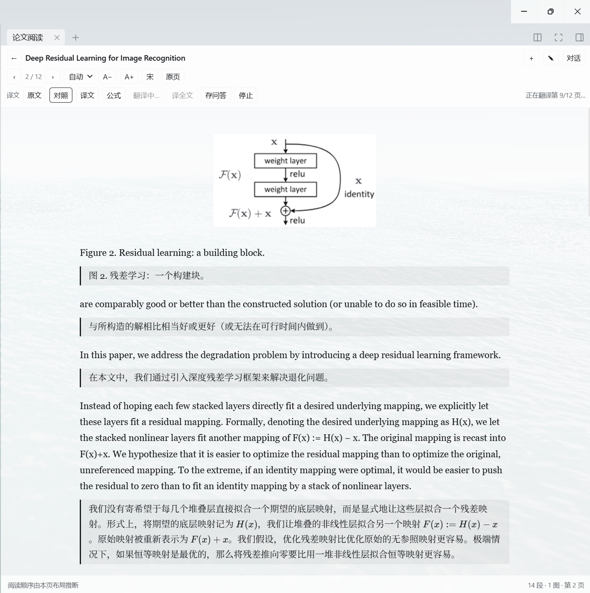

# dsh-paperflow


DSH（DeepSeek Harness）右侧栏论文阅读器：把双栏 PDF / 网页文章按阅读顺序重排，逐段翻译成中文（公式用 KaTeX 渲染），并与左侧原生对话联动。



左：DSH 原生对话；右：论文阅读器（对照模式、KaTeX 公式、整图裁切）。

## 功能

- **PDF 阅读**：双栏/单栏自动识别、阅读顺序重排、图片与表格按区域裁切、页码跳转、原页对照。
- **网页文章**：粘贴公开链接抓取正文，分节阅读；图片通过本地代理加载。
- **翻译**：逐段 / 整页 / 全文，中英对照；译文和原文公式都用 KaTeX 排版。
- **原文公式改写**（可选）：让模型把原文里的数学内容改写成 LaTeX 再渲染。
- **选区提问**：选中一段直接提问，问题注入当前会话；配合 `paper_read` / `paper_search` 工具和页码回跳。
- **笔记**：段级批注；可导出到 Obsidian 风格 vault 的 `sources/self/`，问答可转存 `sources/ai/`。
- **文献库**：文件夹、搜索、改名、删除；支持 arXiv / 网页 / 本地 PDF 入库。
- **本地版面模型**（可选）：PaddleOCR 找整图/表格外框，多张小图拼成的插图也能整张提取。
- **每篇论文独立会话**：一键切换，聊天记录按论文隔离。



## 安装

需要已安装 DSH desktop（Web UI）。

```bash
cd dsh-paperflow
pnpm install
```

在 DSH 中把本目录作为插件 bundle 安装（用 `plugin_manager` 的 `install_bundle` 指向本目录，或把本目录 `link:` 进 profile 的 `dependencies`）。重启 DSH 后，右侧栏会出现「论文阅读」页签。

本插件不修改 DSH 本体；Host 通过 `ctx` 注册 HTTP 路由和工具，Client 通过公开的 slots / 服务接入。

## 配置

在 profile 的 `cordis.patch.yml` 里按插件 id `paper-reflow` 覆盖配置：

```yaml
- id: paper-reflow
  config:
    vaultDir: D:\paper-vault  # 可选：知识库根目录
    dataDir: D:\paper-reader  # 可选：文献库数据目录
    layout:                   # 可选：本地版面模型
      enabled: false
      python: C:\Python312\python.exe
      model: PP-DocLayout-M
```

- `vaultDir`：配置后，笔记导出到 `<vaultDir>/sources/self/`，问答导出到 `<vaultDir>/sources/ai/`；不配置则不写任何文件。
- `dataDir`：默认 `%LOCALAPPDATA%\dsh-paperflow`（首次启动会把旧的 `dsh-paper-reflow` / `dsh-paper-reader` 目录迁移过来）。
- `layout`：可选，开启后用本地 PaddleOCR 版面模型找整图/表格外框（见下）。

## 本地版面模型（可选）

默认关闭。开启后，Host 会把每页渲染成 2x PNG，交给本机 Python 的
[PaddleOCR LayoutDetection](https://www.paddleocr.ai/main/en/version3.x/module_usage/layout_detection.html)
找 `figure` / `table` 外框，再把归一化坐标映射回 PDF 点裁剪。这样由多张小图、
箭头和文字拼成的整图也能作为一张图提取；图注保留为文本。

```bash
# 建议用 python.org 的 3.12/3.13 建独立 venv（Anaconda 的 DLL 环境可能和 Paddle 冲突）
python -m venv .venv-layout
.venv-layout\Scripts\python -m pip install paddlepaddle paddleocr
```

或者直接跑安装脚本（会自动建 venv、装依赖并验证 import）：

```powershell
.\layout\setup.ps1 -Python C:\Python312\python.exe
```

模型能回答的页面不再跑启发式检测，避免误判；模型失败时才回退。

模型在首次推理时自动下载（M ≈ 23 MB，L ≈ 124 MB），之后可离线使用；不需要 API Key，不按页计费。
如果解释器/模型不可用，插件会退回到内置启发式，并在控制台提示一次。

第一次打开一篇论文时，Host 会在后台把其余页面依次跑一遍，结果写进 `papers/<id>/layout.json`；
之后翻页直接读缓存，不再等模型。可以把它理解成“开头慢一次，后面都快”。

注意：页面缓存 key 里带模型名，切换模型会自动重算，不需要手动清缓存。

## 使用

1. 右侧栏打开「论文阅读」→「上传」选 PDF，或粘贴 arXiv / 网页链接。
2. 顶部可切换页码、自动/双栏/单栏、字号、宋体/黑体、原页。
3. 「原文 / 对照 / 译文」切换阅读模式；「译本页」「译全文」调用模型；「公式」改写原文数学内容。
4. 选中正文 → 「问这段 / 记笔记 / 复制」。
5. 笔记面板可「导出到知识库」；提问后可用「存问答」把最近一轮问答写入 `sources/ai`。

快捷键：`←` / `→` 翻页；`Esc` 关闭浮层。

## 结构

```
index.js         Host：HTTP 路由、文献库存储、翻译/公式、笔记与问答导出、工具注册
engine.mjs       PDF 解析：文本行重建、分栏检测、段落切分、表格/图片区域、阅读顺序
layout.mjs       版面模型客户端：worker 生命周期、区域合并、坐标映射
layout/worker.py PaddleOCR 版面检测 worker（可选）
client.js        阅读器 UI：slots 注册、工具栏、选区交互、笔记/文献库、KaTeX 渲染
locale/          侧边栏标题与描述
docs/assets/     README 截图
icon.svg         插件图标
```

Host 的 HTTP 路由统一挂在 `/paper-reflow/*` 下，并用 `connection.requestRejection(req)` 做鉴权。

## 已知限制

- 默认启发式版面分析不支持扫描件（无文本层）、复杂合并单元格、竖排文字；开启版面模型后由模型给整图/表格框，模型漏检的页不会再回退启发式。
- 网页只提取 HTML 正文；纯 JS 渲染、登录后可见的页面可能抓不到；只取 ``，不含 CSS 背景图。
- Node 的 `fetch` 不走系统代理，被墙站点会失败。
- SSRF 防护只覆盖常见内网地址段，不防 DNS rebinding；建议只在本机使用。
- 翻译和公式改写使用 DSH 的默认模型，效果取决于模型。
- 首次打开较大的 PDF 会逐页解析，稍慢；解析结果有缓存。
- 界面文案目前以中文为主。

## 开发

```bash
pnpm install
pnpm check   # node --check：index / client / engine / layout
pnpm test    # 合成 PDF 的烟雾测试（上传、取页、文献库、笔记）
```

CI（GitHub Actions）在 Ubuntu + Node 24 上跑 `pnpm check` 和 `pnpm test`；测试用的
`spike/fixtures/smoke.pdf` 是脚本生成的合成 PDF，不含第三方论文。

`spike/` 下还有开发期的对照实验和版面模型测试；真实论文的 PDF 和生成的图片不入库（见 `spike/README.md`）。

## License

[MIT](./LICENSE)

版本记录见 [CHANGELOG.md](./CHANGELOG.md)。
